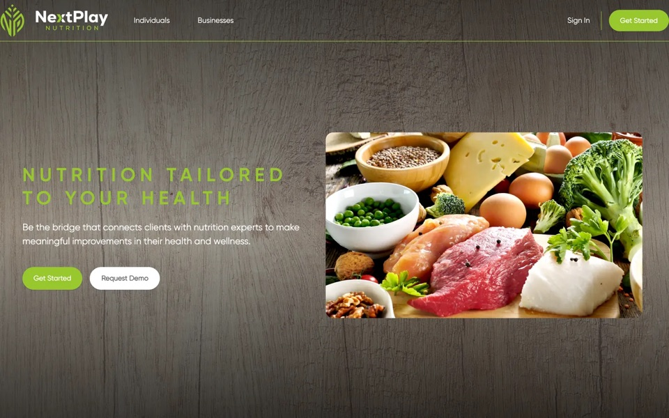
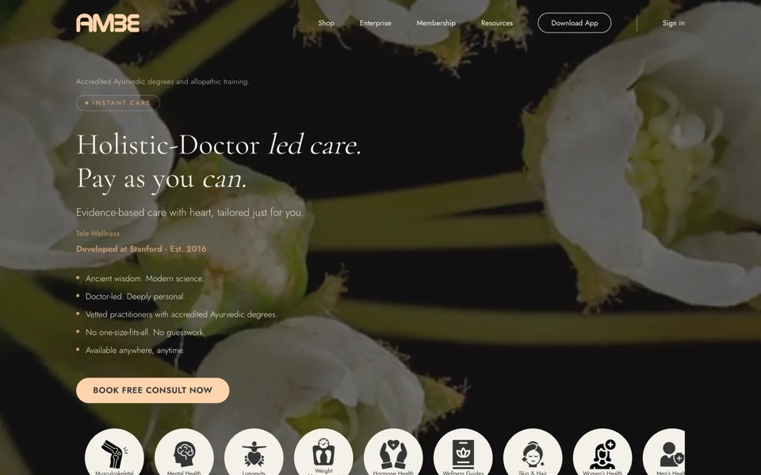
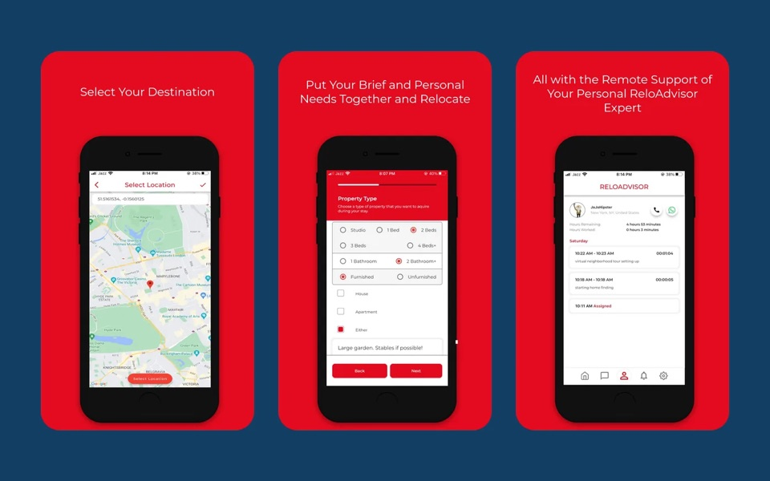
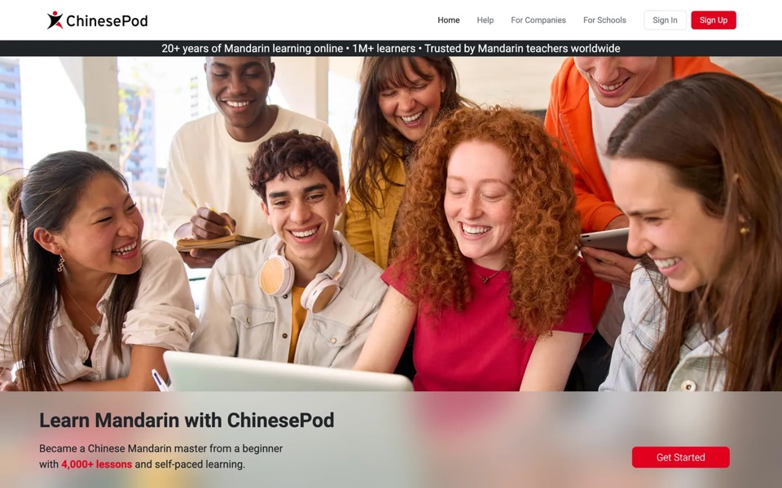
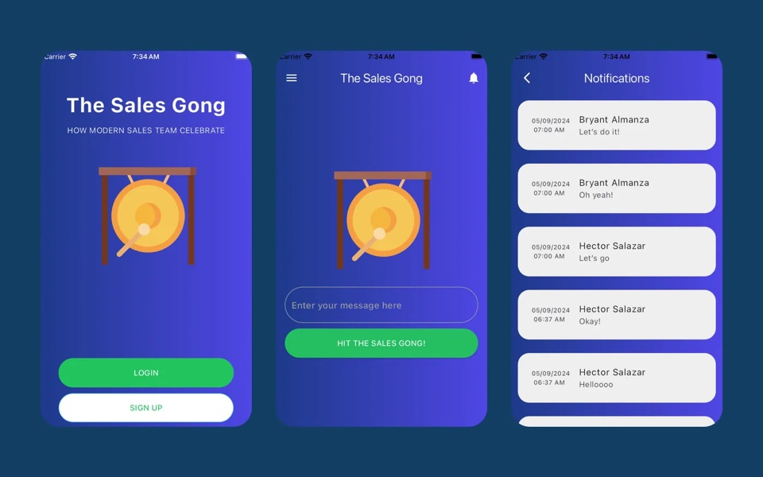
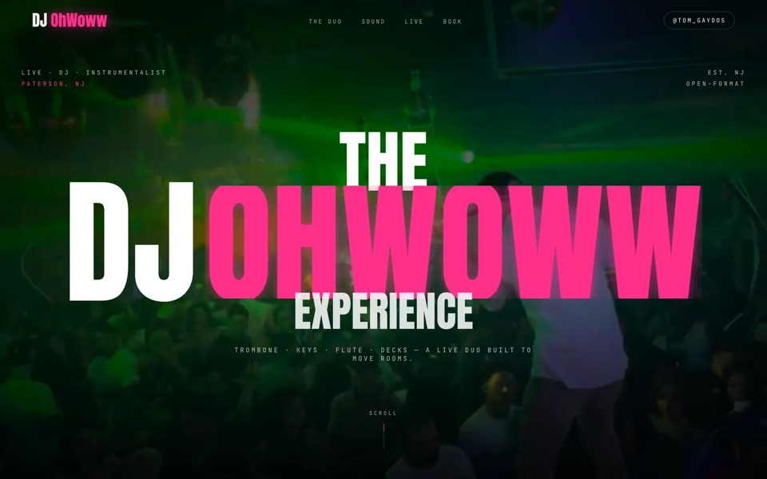

  

  
  
  

I design and build mobile apps, web platforms, and the backends behind them, from the first architecture decisions to the App Store. Most of my client work lives in private repos, so here's what it looks like in production.

## 🚀 Shipped work

<table>
  <tr>
    <td width="50%" valign="top">
      
       <b><a href="https://nextplaynutrition.com">NextPlay Nutrition</a></b>
       HIPAA-compliant, multi-tenant coaching platform I architected and built. Each enterprise client gets its own isolated AWS stack.
       TypeScript · Next.js · Flutter · AWS Lambda · DynamoDB · Cognito
    </td>
    <td width="50%" valign="top">
      
       <b><a href="https://www.ambewellness.com">Ambe Wellness</a></b>
       HIPAA-compliant telehealth platform. I was the sole developer of the mobile app, backend, and website.
       Flutter · Firebase · Next.js
    </td>
  </tr>
  <tr>
    <td width="50%" valign="top">
      
       <b><a href="https://apps.apple.com/us/app/curzonrelo/id1636041231">CurzonRelo</a></b>
       Relocation app for iOS and Android plus the advisor dashboard. On the App Store since 2022, now on version 3.
       Flutter · Firebase · Google Maps
    </td>
    <td width="50%" valign="top">
      
       <b><a href="https://www.chinesepod.com">ChinesePod</a></b>
       Rebuilt the v2 API behind a long-running Mandarin learning platform and led technical decisions on its apps.
       Node.js · REST API
    </td>
  </tr>
  <tr>
    <td width="50%" valign="top">
      
       <b><a href="https://apps.apple.com/us/app/the-sales-gong/id6480072420">The Sales Gong</a></b>
       Team celebration app: close a deal, hit the gong, and everyone gets the alert in real time.
       Flutter · Firebase
    </td>
    <td width="50%" valign="top">
      
       <b><a href="https://www.djohwoww.com">DJ OhWoww</a></b>
       Promotional site for a live DJ duo, built around scroll-driven motion.
       Next.js · Framer Motion
    </td>
  </tr>
</table>

## 🛠️ Tech stack

  

## 🎮 Currently building

- **Brick Hold'Em**: a real-time multiplayer card game with an original rule set and a server that never trusts the client.
- **Gridly**: a number-placement puzzle game with a 60-level campaign and a daily puzzle.

## 🤝 Work with me

I take on new builds, improvements to existing apps, and fractional CTO work. The fastest way to reach me is through [almanzatech.com](https://almanzatech.com) or [Upwork](https://www.upwork.com/freelancers/bryanta4).
